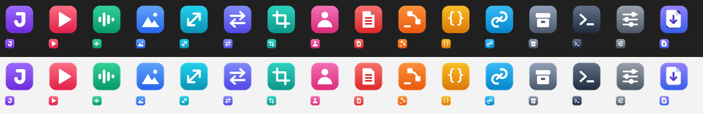

# File Explorer context menu (Windows)

JustTools adds itself to the right-click menu in File Explorer when it is
installed on Windows. All files and folders offer JustZip; other tools appear
when they apply to the selection.

```powershell
just context install     # add the menu for the current user
just context status      # which registration is active
just context uninstall   # remove everything install added
```

No elevation is needed and nothing outside the current user is changed.
The installer and `just install` add the menu automatically; pass
`just install --no-context-menu` to skip it. A menu removed with
`just context uninstall` stays removed through later upgrades until
`just context install` adds it back.



## What the menu shows

| Right-click | Entries |
| --- | --- |
| Video (`.mp4 .mov .mkv .avi .webm` …) | **JustVideo** at 480p, 720p, 1080p, 1440p, 4K, or source resolution, plus more options…; **JustMP3**, **JustAudio**, **JustWAV** to extract the soundtrack |
| Audio (`.mp3 .wav .flac .m4a .ogg` …) | **JustMP3**, **JustAudio**, **JustWAV**, minus the format the file already has |
| Image (`.jpg .png .webp .bmp .tif .qoi`) | **JustOptimize**; **JustResize** to fit 1024, 1920, 2560, or 3840 px, plus more options…; **JustWebP**, **JustAVIF**, **JustJPG**, **JustPNG**; **JustCrop**, **JustRMBG** |
| PDF | **JustPDF** merge (two or more), compress, compress smallest, split into pages, save embedded images, save links, show details, more options…; **JustLinks** |
| SVG / JSON | **JustOptimize** and **JustSVG** for SVG; **JustJSON** format, minify, validate |
| Office, Markdown, HTML, text, CSV | **JustLinks** to `links.txt` or `links.csv` |
| Folder, or a folder's empty background | **JustPaste** saves clipboard images, copies files with saved filters, or downloads links into that folder; JustOptimize, JustResize, JustWebP, JustVideo, JustMP3, and JustLinks launchers opened in that folder |
| Any file, folder, mixed selection, or a folder's empty background | **JustZip**: smallest ZIP (default), balanced ZIP, fast ZIP, preview included files, more options… |

Every choice is its own row in the JustTools flyout, such as
**JustVideo · 1080p**. The Windows 11 menu does not draw a flyout nested inside
another, so the menu is one level deep by design.

**JustPaste · paste here** uses a folded-sheet icon on a violet-to-blue tile,
matching its tray icon and native settings window. Windows draws the Explorer
menu itself, including its theme, spacing, and keyboard navigation.

Every menu ends with **Open JustTools here**, which opens the `just` tool
browser in that folder. `.ts` and `.mts` offer ZIP actions but no video actions
because they are far more often TypeScript than video.

A mixed selection shows every tool that can read at least one selected file,
and each tool is given only the files it reads. JustZip receives the whole
selection and creates one archive.

## What a click does

A console window opens, prints the exact **Headless:** command and the folder
it runs in, and runs it. That command is what a terminal user would type, so
the menu never does anything the command line cannot.

- Every window closes by itself: after about three seconds when the run
  succeeded, and after thirty when it failed or the result is something to read
  (PDF details and compression results, JSON validation, ZIP preview).
- Enter closes it at once; any other key stops the countdown and keeps the
  window open until Enter.
- Entries ending in **…** open the tool's [console launcher](console-ui.md)
  with the selection filled in, so saved defaults and every option apply.

## Defaults

Menu entries use each tool's built-in defaults plus the one setting the entry
names; saved launcher defaults apply only to the **…** entries.

JustPaste explicitly passes `--saved-settings` so its copy exclusions and
text-to-file toggle match Smart Paste's tray settings. Its destination is always
the clicked folder, independent of the launcher's saved output folder.

| Entry | Command | Result |
| --- | --- | --- |
| JustVideo · 1080p | `justvideo --resolution 1080p` | `<name>-web.mp4`, never upscaled, source kept |
| JustMP3 / JustAudio / JustWAV | `justmp3`, `justaudio`, `justwav` | `<name>.mp3` / `.m4a` / `.wav`, source kept |
| JustOptimize | `justoptimize` | `<name>-optimized.<best>` (SVG stays `.svg`), source kept |
| JustResize · fit 2560 px | `justresize --max 2560` | `<name>-resized.<same>`, source kept |
| JustWebP / JustAVIF | `justwebp --output .`, `justavif --output .` | `<name>.webp` / `.avif` beside the source, **source kept** |
| JustJPG | `justjpg` | `<name>-optimized.jpg`, source kept |
| JustPNG · compress in place | `justpng` | Replaces the PNG only when the result is smaller |
| JustCrop / JustRMBG | `justcrop`, `justrmbg` | `<name>-cropped.<same>` / `<name>-nobg.png`, source kept |
| JustPaste | `justpaste --clipboard --saved-settings` | Clipboard image as PNG, filtered file copy, or downloaded link; a taken name is numbered, never overwritten |
| JustZip · smallest ZIP (default) | `justzip <inputs...>` | `<name>.zip` for one input, `archive.zip` for several, beside the first selected item; sources kept |
| JustZip · balanced ZIP / fast ZIP | `justzip --compression balanced <inputs...>` / `justzip --compression fast <inputs...>` | Same destination with the selected compression; sources kept |
| JustZip · preview included files | `justzip --dry-run <inputs...>` | Shows the destination and included entries without writing |
| JustSVG, JustJSON Format/Minify | `justsvg`, `justjson`, `justjson --minify` | Rewrites the file in place |

JustZip includes ordinary folders recursively, including empty folders, and
uses Git's tracked and unignored file list for Git folders and their subfolders.
Explicit files are included even if ignored. A single folder contributes its
contents; multiple selections retain each file or folder's name. For one file,
the ZIP name includes the original extension: `notes.txt.zip`. A folder's
background archives that folder, with its ZIP beside it.

An existing ZIP at the destination is replaced atomically, matching `justzip`;
sources stay intact. Conflicting names inside an archive and a destination
that would replace a selected source are rejected before writing.
**More options…** opens the launcher with every selected item filled in and the
same default destination, allowing a different output path and saved compression.
See the [JustZip guide](zip.md) for naming, Git behavior, and symlinks.

Entries that change a file in place say so. JustWebP and JustAVIF normally
remove a source once a smaller result exists; the menu passes `--output .` so
a right-click never deletes anything. The menu never passes `--yes`; tools that
require overwrite confirmation still ask in the console window.

## Windows 11 top-level menu

Windows 11 only lets an app with a package identity into its top-level menu.
`just context install` uses the best registration available:

| Registration | Appears | Needs |
| --- | --- | --- |
| Package | Top-level Windows 11 menu | A signed `justtools-shell.msix` beside `just.exe`, **or** Developer Mode (Settings > System > For developers) |
| Classic | "Show more options" on Windows 11 (also Shift+right-click); the normal menu on Windows 10 | Nothing |

`just context install --classic` forces the classic registration. Only one
registration is active at a time. `just install` refreshes a menu that the
installed copy registered, and leaves a menu registered by another copy alone.

If JustTools appears but its flyout is empty, update both `just.exe` and
`justtools_shell.dll` from the same build, then run `just context install`.
The extension handles the selection callbacks used by both the Windows 11
menu and "Show more options"; opening either flyout shows the applicable tools.
Explorer can cache a previous registration in an already-open window. Close
and reopen that Explorer window before testing the repaired menu.

Windows normally registers the package in a few seconds. If its app deployment
service stalls, JustTools stops waiting after 60 seconds, registers the classic
menu instead, and says so. Restarting Windows clears a stuck deployment; run
`just context install` afterwards for the top-level menu.

The menu is served by `justtools_shell.dll`, which ships in the Windows release
archives and is copied beside `just.exe` by `just install`. When building from
source, build it too:

```sh
cargo build --locked --release -p justtools -p justtools-shell
./target/release/just install
```

Tagged Windows releases require the
`JUSTTOOLS_SIGNING_PFX` (base64 PFX) and `JUSTTOOLS_SIGNING_PASSWORD` secrets,
which sign and timestamp the executable, DLL, and `justtools-shell.msix` in the
Windows archives; the certificate must chain to a root the user's machine
trusts. Branch builds can be unsigned. A current Defender scan of the payload
and ZIP must also pass. See [Windows release verification](windows-security.md).

## How it is built

- `explorer/menu` is the menu itself: which tools read which extensions, the
  entries for a selection, and the command behind each entry. It is plain Rust,
  tested on every platform, and shared by the extension and the CLI.
- `explorer/shell` is the Explorer extension (`IExplorerCommand`). It asks the
  model what to show and starts `just.exe context run <entry>`.
- `explorer/icons/build.py` draws the icons; the generated files are committed.
